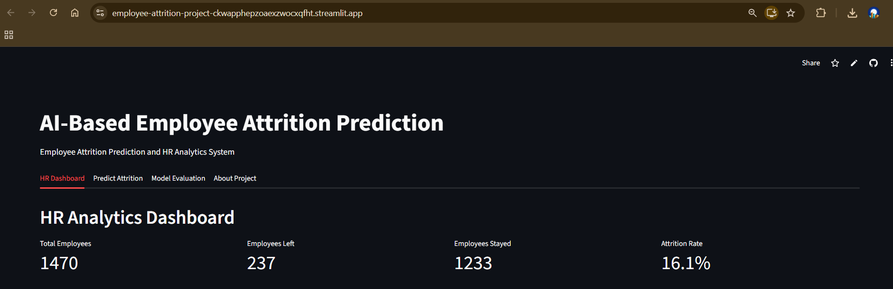

# AI-Based Employee Attrition Prediction and HR Analytics System

## Project Overview

This project uses Machine Learning to predict employee attrition risk and provide HR analytics through an interactive Streamlit web application.

The system analyzes employee data and estimates the likelihood of employees leaving an organization. It also provides useful insights to support HR analysis.

## Technologies Used

- Python
- Pandas
- Scikit-learn
- Random Forest Classifier
- Streamlit
- Machine Learning
- GitHub

## Key Features

- HR analytics dashboard
- Employee attrition risk prediction
- Model evaluation metrics
- Department-wise attrition analysis
- Overtime vs. attrition analysis
- Feature importance visualization
- Interactive web application

## Application Screenshot

## Model Evaluation

The model was evaluated using a test dataset.

| Metric | Score |
|---|---:|
| Accuracy | 81.97% |
| Precision | 44.44% |
| Recall | 51.06% |
| F1 Score | 47.52% |

Note: These metrics depend on the test dataset and prediction threshold. The model provides estimates, not guaranteed outcomes.

## Machine Learning Model

The project uses a Random Forest Classifier to estimate employee attrition probability.

The application displays a predicted risk category based on illustrative thresholds:

- Low Risk: Below 30%
- Medium Risk: 30% to below 60%
- High Risk: 60% or above

These thresholds have not been validated for real-world HR decisions.

## Live Demo

Add your deployed Streamlit application URL here.

## GitHub Repository

https://github.com/bharathsankar5018-png/employee-attrition-project

## Project Purpose

This project was developed as a BCA Data Science machine learning project to demonstrate data analysis, model development, evaluation, and web application deployment.

## Disclaimer

This project is for educational and demonstration purposes only. Predictions should not be used as the sole basis for employment decisions.
